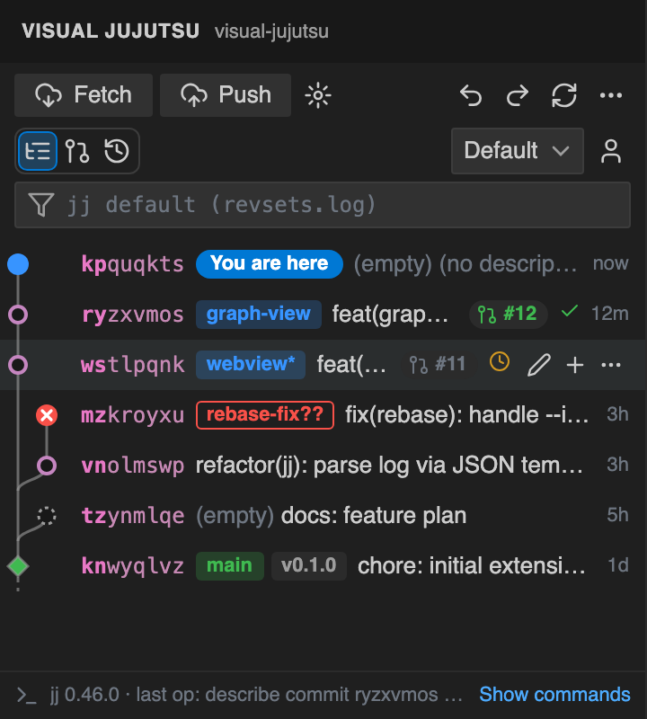
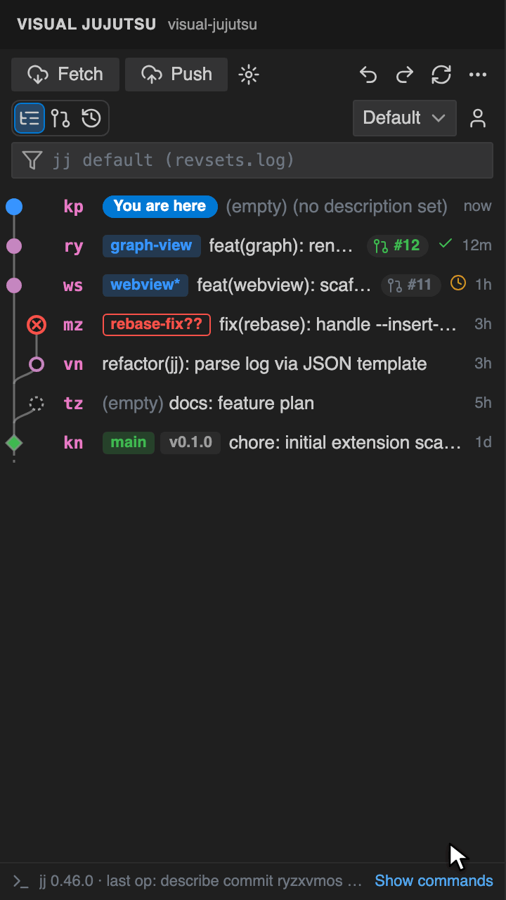
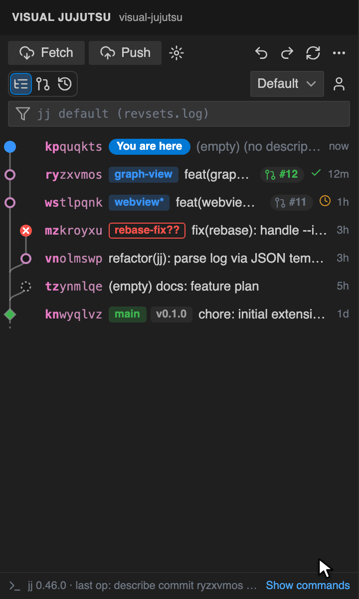
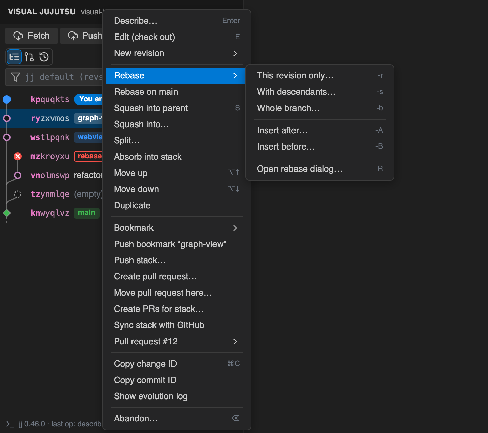
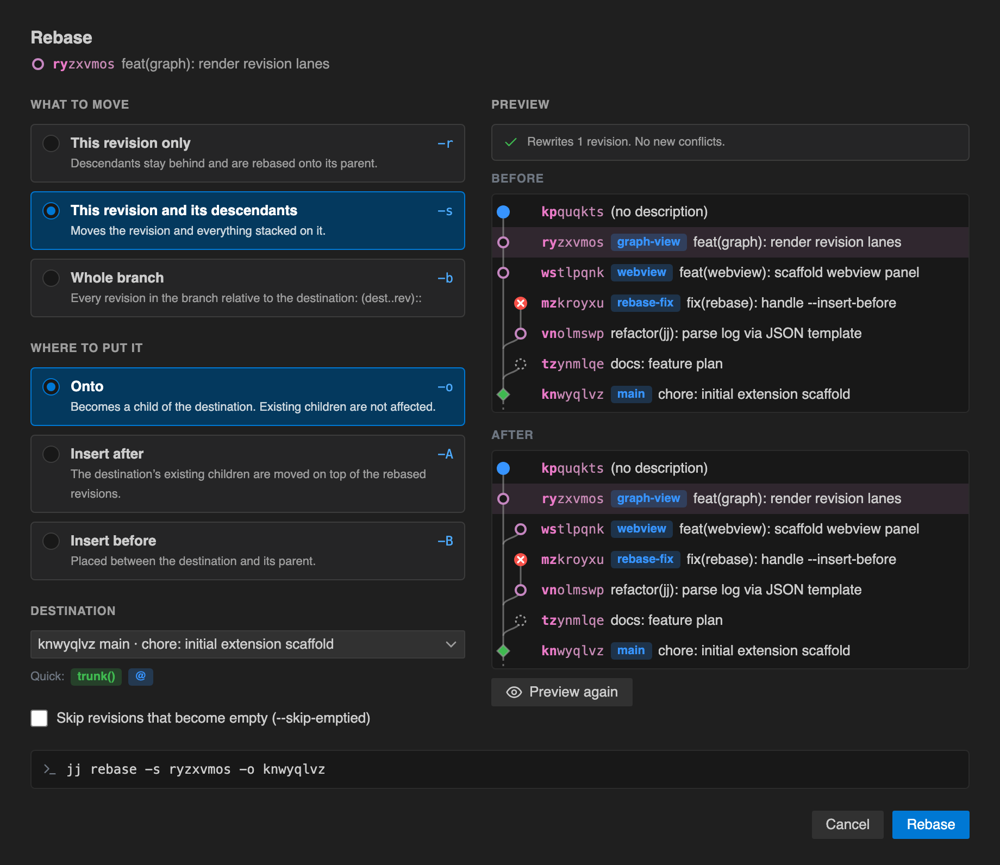
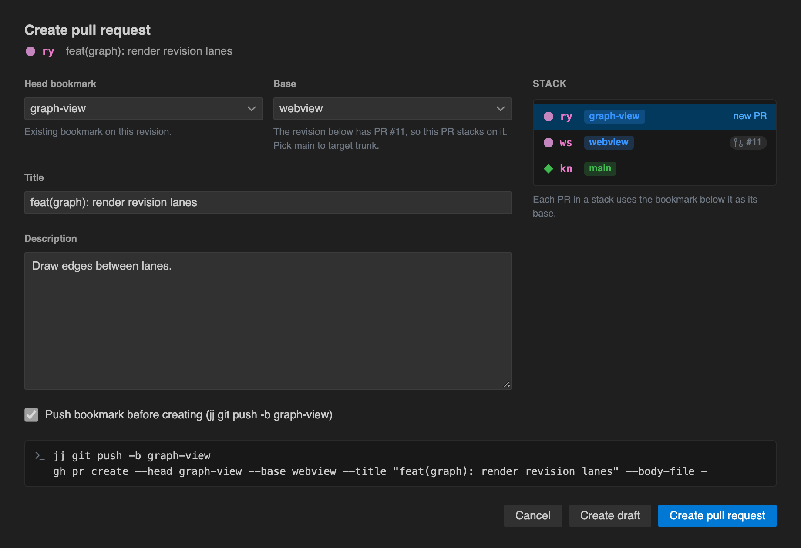

# Visual Jujutsu

A VS Code extension for [Jujutsu (jj)](https://github.com/jj-vcs/jj): see your revision graph and change it directly. Every action runs a real `jj` (or `gh`) command, which you can see in the command log, and anything can be undone with ⌘Z.

<p align="center">
  
</p>

## The graph

The sidebar shows your revisions the way `jj log` does:

- The working copy (●, “You are here”), your mutable revisions (○), trunk and other immutable revisions (◆), conflicts (red ✕) and empty revisions (dashed).
- Bookmarks, tags and remote bookmarks. A `*` means the local bookmark differs from the remote, and `??` means it is conflicted.
- Pull request number and CI status for any bookmark with a GitHub PR.
- Filter with any revset, or pick a preset: Default, Mine, Stack of @, All, Bookmarks.

Click a revision to see its changed files with line counts, then click a file to open a diff. Hover a row for quick actions (describe, new, more), or double-click it to edit the description inline.

## Move files between revisions

Drag files from one revision onto another to move those changes. Select several files with ⌘-click. A hint shows the exact command before you let go.

<p align="center">
  
</p>

You can also right-click a file and choose **Move to revision…** or **Move into parent**.

## Rebase by drag and drop

Drag a revision onto another one to rebase it. By default it moves with its descendants (`-s`). Hold **⌥** to move only that revision (`-r`), or **⇧** to move the whole branch (`-b`). Drop on a row's top or bottom edge to insert before (`-B`) or after (`-A`) it.

<p align="center">
  
</p>

Drag a bookmark chip onto a revision to move that bookmark. It asks first if the move would go backwards or sideways.

## Everything in the context menu

Right-click any revision for describe, edit, new (on top, insert after, insert before), rebase, rebase on main, squash, bookmarks, push, pull requests, copy IDs and abandon.

<p align="center">
  
</p>

## Rebase dialog

For full control, **Open rebase dialog…** shows every `jj rebase` option, a destination picker, and the command that will run.

<p align="center">
  
</p>

## Pull requests

**Create pull request…** pushes the bookmark (creating one if the revision has none) and opens the PR with `gh`. If the revision below already has a PR, the new PR's base is set to that PR's bookmark, so stacked PRs work out of the box. **Move pull request here…** moves a PR's bookmark to another revision and pushes it.

<p align="center">
  
</p>

## Also included

- **Fetch** and **Push** in the toolbar. If a push is rejected, the error offers **Fetch and retry**.
- **Undo / redo** (⌘Z / ⇧⌘Z in the graph), and destructive actions ask for confirmation first.
- Keyboard: ↑/↓ select, → / ← expand or collapse, Enter describe, N new, E edit, S squash, R rebase dialog, ⌫ abandon.
- A **command log** (“Show commands”) listing every `jj` and `gh` command the extension ran.
- A status bar item showing the working copy's change ID, description and conflicts.

Features that are planned but not built yet already appear in the UI and say “not supported yet”. See [FEATURES.md](FEATURES.md) for the roadmap.

## Requirements

- `jj` 0.27 or later on your PATH (or set `visualJujutsu.jjPath`). Redo needs 0.33 or later.
- For pull requests: the [GitHub CLI](https://cli.github.com) `gh`, logged in, and a GitHub remote.

## Settings

| Setting | Default | |
|---|---|---|
| `visualJujutsu.jjPath` | `jj` | Path to the jj executable |
| `visualJujutsu.ghPath` | `gh` | Path to the GitHub CLI |
| `visualJujutsu.defaultRevset` | (jj's default) | Revset shown when the graph opens |
| `visualJujutsu.savedRevsets` | `[]` | Extra presets: `[{ "name": "…", "revset": "…" }]` |
| `visualJujutsu.logLimit` | `200` | Maximum revisions to load |
| `visualJujutsu.fetchBeforeRebaseOnTrunk` | `true` | Fetch before “Rebase on main” |
| `visualJujutsu.pullRequestBookmarkPrefix` | `push-` | Prefix for bookmarks created for new PRs |
| `visualJujutsu.confirmDestructiveActions` | `true` | Ask before abandoning or moving bookmarks backwards |

## Development

```bash
npm install
npm run build        # bundles dist/extension.js and dist/webview.js
npm test             # unit + integration tests (needs jj)
npm run test:e2e     # runs the extension inside VS Code against a scratch repo
npm run screenshots  # regenerates the PNGs in docs/images (needs: npx playwright install chromium)
npm run gifs         # regenerates the GIFs in docs/images (also needs ImageMagick)
```

Press F5 in VS Code to launch an Extension Development Host. To work on the UI in a browser, serve the repo (`python3 -m http.server 5178`) and open `webview/dev.html?mode=graph` (or `rebase`, `createPr`). It uses a fake host with sample data that simulates rebases and file moves, which is also what the screenshots and GIFs show.

Releases are published by the GitHub Actions workflow in `.github/workflows/publish.yml` when a `v*` tag is pushed.
